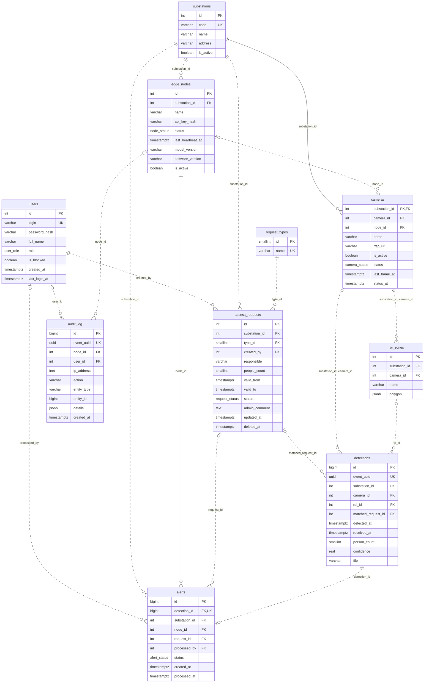

# БД центра

Центральная PostgreSQL содержит 10 прикладных таблиц. Диаграмма показывает схему после [миграции 0005](central-service/backend/migrations/versions/0005_kafka_camera_events.py). `PK` обозначает первичный ключ, `FK` — внешний, `UK` — уникальный.

## `users`: учётные записи

|Поле|Тип|Назначение|
|---|---|---|
|`id`|int, PK|Внутренний номер пользователя. На него ссылаются заявки, тревоги и журнал, поэтому смена логина ничего не ломает|
|`login`|varchar, UK|Логин для входа. Уникален, но не служит ключом связей|
|`password_hash`|varchar|Хеш пароля, сам пароль не хранится|
|`full_name`|varchar|ФИО для интерфейса и карточки тревоги|
|`role`|user_role|Роль для разграничения прав в приложении: `dispatcher`, `admin`, `auditor`|
|`is_blocked`|boolean|Признак блокировки. Пользователей блокируют, а не удаляют, чтобы сохранить авторство в журнале|
|`created_at`|timestamptz|Когда учётная запись создана|
|`last_login_at`|timestamptz|Время последнего входа|

## `substations`: подстанции

|Поле|Тип|Назначение|
|---|---|---|
|`id`|int, PK|Номер подстанции, корень иерархии|
|`code`|varchar, UK|Короткий стабильный код (например, `PS-110-01`) для импорта и интеграции|
|`name`|varchar|Человекочитаемое название для интерфейса|
|`address`|varchar|Адрес или местоположение|
|`is_active`|boolean|Ведётся ли наблюдение. Выведенную из работы подстанцию можно отключить, не удаляя историю|

## `edge_nodes`: локальные узлы

На подстанции может быть несколько узлов. Имя узла уникально в пределах подстанции (`UNIQUE (substation_id, name)`).

|Поле|Тип|Назначение|
|---|---|---|
|`id`|int, PK|Номер узла|
|`substation_id`|int, FK|Подстанция, на которой установлен узел|
|`name`|varchar|Имя узла для администратора|
|`api_key_hash`|varchar|Хеш ключа, по которому узел аутентифицируется в центре|
|`status`|node_status|Состояние узла (например, онлайн или нет связи)|
|`last_heartbeat_at`|timestamptz|Максимальное принятое `Time` heartbeat конкретного узла; строго более новое значение переводит его в `online`|
|`model_version`|varchar|Версия модели YOLO на узле. Здесь поле оправдано: узлы обновляются не одновременно|
|`software_version`|varchar|Версия программы узла|
|`is_active`|boolean|Подключён ли узел к работе|

## `cameras`: камеры

|Поле|Тип|Назначение|
|---|---|---|
|`substation_id`|int, PK, FK|Подстанция из поля `Sender`. Первая часть ключа камеры|
|`camera_id`|int, PK|Положительный номер, присвоенный на подстанции. Вторая часть ключа|
|`node_id`|int, FK|Узел, который обрабатывает видео камеры. Необязательное: камеру можно внести в справочник до назначения узла|
|`name`|varchar|Название («Периметр, север»)|
|`rtsp_url`|varchar|Адрес RTSP-потока|
|`is_active`|boolean|Включена ли камера в мониторинг|
|`status`|camera_status|Техническое состояние (работает, нет сигнала)|
|`last_frame_at`|timestamptz|Время последнего полученного кадра|
|`status_at`|timestamptz|Время `Time` последнего принятого изменения состояния. Пусто до первого статуса Kafka|

Составной внешний ключ `(node_id, substation_id)` → `edge_nodes (id, substation_id)` не даёт назначить камере узел с другой подстанции. Он задаётся в SQL и на диаграмме Mermaid не виден.

## `roi_zones`: зоны интереса

|Поле|Тип|Назначение|
|---|---|---|
|`id`|int, PK|Номер зоны|
|`substation_id`|int, FK|Первая часть ссылки на камеру зоны|
|`camera_id`|int, FK|Номер камеры зоны в пределах подстанции|
|`name`|varchar|Название зоны («Трансформатор Т-1»)|
|`polygon`|jsonb|Вершины полигона списком координат|

## `request_types`: типы заявок

|Поле|Тип|Назначение|
|---|---|---|
|`id`|smallint, PK|Номер типа|
|`name`|varchar, UK|Вид работ: ремонт, обход, проверка|

## `access_requests`: заявки на доступ

|Поле|Тип|Назначение|
|---|---|---|
|`id`|int, PK|Номер заявки|
|`substation_id`|int, FK|Подстанция, на которую выдано разрешение|
|`type_id`|smallint, FK|Тип заявки|
|`created_by`|int, FK|Кто оформил заявку|
|`responsible`|varchar|Ответственный или бригада|
|`people_count`|smallint|Сколько людей заявлено|
|`valid_from`|timestamptz|Начало действия|
|`valid_to`|timestamptz|Конец действия|
|`status`|request_status|Статус (например, ожидает, активна, закрыта, отклонена). Тревога подавляется только при активной заявке|
|`admin_comment`|text|Служебный комментарий администратора|
|`updated_at`|timestamptz|Время последнего изменения заявки. PostgreSQL обновляет его при каждом изменении строки|
|`deleted_at`|timestamptz|Время мягкого удаления заявки в центре. Строка сохраняется для истории и ссылок из детекций и тревог|

## `detections`: детекции

|Поле|Тип|Назначение|
|---|---|---|
|`id`|bigint, PK|Внутренний номер детекции в центре|
|`event_uuid`|uuid, UK|Идентификатор, созданный узлом. Защищает от дублей при повторной отправке|
|`substation_id`|int, FK|Подстанция, обе части ссылки на камеру обязательны|
|`camera_id`|int, FK|Номер камеры детекции в пределах подстанции|
|`roi_id`|int, FK|Зона интереса. Необязательное: пусто, если человек вне зон|
|`matched_request_id`|int, FK|Заявка, подходящая по подстанции и времени обнаружения. Поле предназначено для автоматического сопоставления в центре и при приёме детекции может быть пустым|
|`detected_at`|timestamptz|Момент обнаружения по часам узла|
|`received_at`|timestamptz|Когда центр получил детекцию от узла|
|`person_count`|smallint|Сколько людей в кадре|
|`confidence`|real|Уверенность модели от 0 до 1|
|`file`|varchar|Исходная строка пути от узла. У исторических записей сохраняется значение прежнего `frame_key`|

## `alerts`: тревоги

|Поле|Тип|Назначение|
|---|---|---|
|`id`|bigint, PK|Внутренний номер тревоги|
|`detection_id`|bigint, FK, UK|Обязательная ссылка на детекцию. Каждая детекция может породить максимум одну тревогу|
|`substation_id`|int, FK|Подстанция, к которой относится тревога. Индекс по `(substation_id, status, created_at)` поддерживает поиск свежих тревог по подстанции|
|`node_id`|int, FK|Узел, приславший детекцию, по которой центр создал тревогу|
|`request_id`|int, FK|Заявка, которую диспетчер привязал кнопкой «Связать с заявкой». Необязательное|
|`processed_by`|int, FK|Кто обработал тревогу. Необязательное, пока тревога новая|
|`status`|alert_status|`new`, `confirmed`, `false_positive`, `linked`|
|`created_at`|timestamptz|Когда центр создал тревогу|
|`processed_at`|timestamptz|Когда диспетчер обработал тревогу|

## `audit_log`: журнал действий

|Поле|Тип|Назначение|
|---|---|---|
|`id`|bigint, PK|Номер записи. Записи только добавляются|
|`event_uuid`|uuid, UK|Идентификатор события для защиты от дублей|
|`node_id`|int, FK|Узел, сообщивший событие. Пусто для действий в центре|
|`user_id`|int, FK|Кто совершил действие. Пусто для системных событий|
|`ip_address`|inet|IP-адрес, с которого пришёл запрос|
|`action`|varchar|Операция коротким кодом (`login`, `alert_confirm` и т. д.)|
|`entity_type`|varchar|Вид объекта, над которым выполнено действие|
|`entity_id`|bigint|Номер объекта. Настоящего внешнего ключа нет, чтобы запись переживала удаление объекта|
|`details`|jsonb|Для событий Kafka содержит подстанцию, номер камеры, время и данные события. Для отклонённых сообщений — координаты в Kafka и причину|
|`created_at`|timestamptz|Время события, ставится базой|

`audit_log.id` идентифицирует строку журнала, а уникальный `event_uuid` позволяет распознать повторную доставку события. Триггер защищает журнал от изменения и удаления записей.

### Связи между таблицами

|№|Сущность 1|Связь|Сущность 2|
|---|---|---|---|
|1|users|1 → 0..N|access_requests|
|2|users|0..1 → 0..N|alerts|
|3|users|0..1 → 0..N|audit_log|
|4|substations|1 → 0..N|edge_nodes|
|5|substations|1 → 0..N|cameras|
|6|substations|1 → 0..N|access_requests|
|7|substations|1 → 0..N|alerts|
|8|edge_nodes|0..1 → 0..N|cameras|
|9|edge_nodes|1 → 0..N|alerts|
|10|edge_nodes|0..1 → 0..N|audit_log|
|11|request_types|1 → 0..N|access_requests|
|12|access_requests|0..1 → 0..N|alerts|
|13|access_requests|0..1 → 0..N|detections|
|14|cameras|1 → 0..N|roi_zones|
|15|cameras|1 → 0..N|detections|
|16|roi_zones|0..1 → 0..N|detections|
|17|detections|1 → 0..1|alerts|

### Проектный сценарий работы

Consumer центра принимает через Kafka детекции, статусы камер и heartbeat узлов. Контракты описаны в [README центра](central-service/README.md).

1. Камера передаёт RTSP-поток на узел, воркер берёт 2-5 кадров в секунду и передаёт их в YOLO, который ищет человека.
2. Если человек найден, узел определяет зону интереса (`roi_id`), сохраняет снимок в локальное хранилище и создаёт запись в `detections` со своим `event_uuid` и временем `detected_at`. Повторные детекции одного и того же человека узел объединяет в одно событие, чтобы не плодить дубли.
3. Узел записывает детекцию и строку в `outbox` в одной транзакции. Воркер публикует событие в Kafka и при сбое повторяет отправку с прежним `id`.
4. Consumer проверяет камеру по `(Sender, camera_id)` и принадлежность зоны, сохраняет исходный `file` и резервирует UUID события в журнале в той же транзакции.
5. При `is_alert=true` центр выбирает активную неудалённую заявку подстанции на `detected_time` включительно. При перекрытии выбирается наиболее позднее начало, затем меньший ID. Совпадение записывается в `detections.matched_request_id`. При отсутствии заявки создаётся тревога `new` с узлом камеры. Если узел не назначен, сохраняется отказ. При `is_alert=false` сохраняется обычная детекция.
6. Диспетчер видит новую тревогу в ленте и нажимает «Подтвердить», «Ложное срабатывание» или «Связать с заявкой». В `alerts` обновляются `status`, `processed_by`, `processed_at` и при необходимости `request_id`.
7. Администратор правит заявки прямо в центре. Узлу об этом знать не нужно: заявки на узел не передаются, поэтому устаревшая копия не может подавить настоящую тревогу.
8. При потере или восстановлении связи с камерой узел публикует её состояние в Kafka. Центр определяет камеру по `(Sender, Camera_id)`, записывает событие в `audit_log` и учитывает `Time` при обновлении статуса, чтобы запоздавшее сообщение не заменило более свежее состояние.
9. Все действия пользователей и системные события (создание тревоги, потеря камеры, `offline` узла) попадают в `audit_log`.

